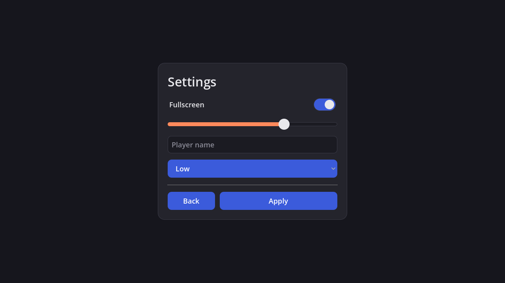
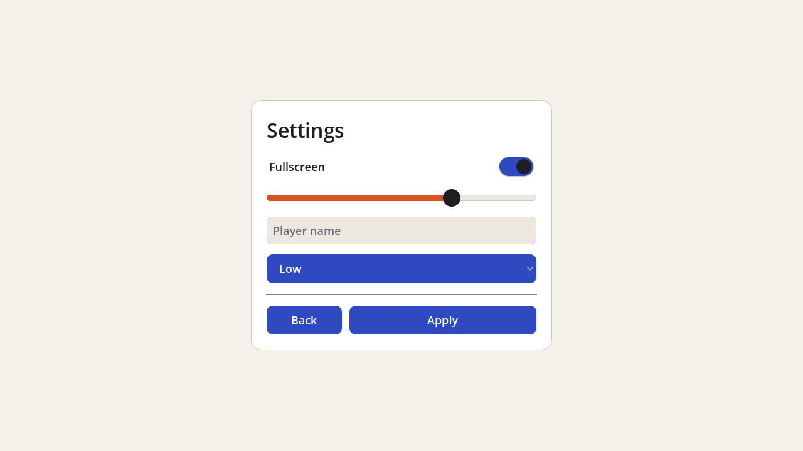

# Figma to Godot

Turn Figma frames into Godot UI scenes, and Figma variables into Godot Themes.

Part of [Walker](https://github.com/nikbearbrown/walker), the framework for building games with AI agents.

## Executive summary

**What it is.** A converter. You give it a Figma design (frames, auto-layout, components, color and number variables). It gives you Godot `.tscn` scenes built from real `Control` nodes, plus one `Theme` per Figma variable mode (Dark, Light, ...).

**Why we are building it.** UI is a large share of the work in most games: menus, HUD, settings, inventory, dialogue, translations, many resolutions. In Godot it means assembling dozens of nodes and a theme by hand, then redoing it whenever the design changes. Figma already holds that design. Converting it, instead of retyping it, removes the repetitive part and lets a designer change a color variable once and update every screen. The full argument is in [docs/WHY.md](docs/WHY.md).

**What was found.** It works end to end on a real Figma file. A test file with four theme modes, shared components and seven phone screens was exported with the bundled exporter and converted. All seven screens load in Godot 4.7.2 without errors, and swapping the theme re-colors them (checked by script and by rendered screenshots, not only by reading the generated text).

The first real export also exposed bugs a hand-written example had hidden, and each is now fixed and covered by a test: Figma sends component properties as strings (`"0.7"`, `"False"`), so a slider crashed the converter and an unchecked toggle rendered checked; a single-mode "Metrics" collection became a bogus theme; empty spacer frames were dropped; and button style variants (primary, secondary, tertiary) all rendered the same. Rendering also showed that Godot's default toggle and slider icons ignore the theme, so those icons are now generated per mode.

**What is not done.**
- One direction only: Figma to Godot. Edits in Godot do not go back.
- The exporter has run on one real Figma file (by the author, through the Figma MCP). Other files will find more cases.
- Fonts, shadows, vector art and images are not imported yet. Every build writes a report of what it dropped; [docs/MAPPING.md](docs/MAPPING.md) lists it all.
- Tested on Godot 4.7.2 on a Mac only. Nothing was tested on a phone.

## How it works

```
Figma file ──exporter──▶ design.json ──figma2godot──▶ scenes/*.tscn
 (frames, variables)     (schema 0.1)                 theme/theme_<mode>.tres
                                                      figma_import_report.md
```

1. **Export.** Claude, using the Figma MCP, runs `exporter/export.js` on your file (through `use_figma`). Or any tool that emits the [design JSON](docs/SCHEMA.md).
2. **Convert.** `figma2godot` is plain Python with no dependencies. It is deterministic: the same JSON always gives the same scenes.
3. **Verify.** Godot loads every scene headless and swaps modes. A second script renders screenshots.




Same scene, same file. Only the Figma mode changed.

## Use it

Requires Python 3.9+ and Godot 4.4+ (tested on Godot 4.7.2 only).

```bash
git clone https://github.com/nikbearbrown/figma-to-godot.git
cd figma-to-godot
python3 -m figma2godot build examples/game-ui.design.json --project examples/godot-demo
```

That writes into the project's `figma/` folder:

- `scenes/MainMenu.tscn`, `Settings.tscn`, `HUD.tscn`
- `theme/theme_dark.tres`, `theme/theme_light.tres`
- `theme/figma_theme.gd`, a helper: `FigmaTheme.apply($MainMenu, "Light")`
- `figma_import_report.md`

Open `examples/godot-demo` in Godot and run it, or use `--project` with your own game.

### Verify

```bash
python3 -m unittest discover -s tests -t .
godot --headless --path examples/godot-demo --script ../../tests/godot_check.gd
godot --path examples/godot-demo --script ../../tests/godot_shots.gd -- "$PWD/docs/img"
```

The first runs the converter's tests. The second loads every scene in Godot and checks that the Light theme really differs from Dark. The third renders screenshots (needs a window).

### In your Figma file

The mapping depends on conventions, so name things on purpose:

- Variables: `color/bg`, `color/panel`, `color/text`, `color/accent`, `color/button`, `radius/button`, `font-size/body`, and so on. [docs/MAPPING.md](docs/MAPPING.md) has the list. Missing ones fall back to defaults and are reported.
- Bind fills and text colors to variables, not literal hex. Bound colors follow the mode.
- Use auto-layout for anything that should be responsive.
- Name components `Button`, `Toggle`, `Slider`, `Text Field`, `Dropdown`, `Progress Bar`, `Divider`, `Icon`, or tag them with plugin data `godotType`.

### With Claude

[skill/figma-godot/SKILL.md](skill/figma-godot/SKILL.md) is a Claude skill in the same style as the Figma MCP's own `figma-swiftui`. Copy `skill/figma-godot` into your skills folder and ask for "this Figma frame as a Godot scene".

## Layout of this repo

| Path | What |
|---|---|
| `figma2godot/` | The converter (Python, standard library only) |
| `exporter/export.js` | Figma Plugin API script that produces the design JSON (run live on one file) |
| `skill/figma-godot/` | Claude skill: the workflow end to end |
| `examples/` | Example design JSON and a Godot project with the generated output |
| `tests/` | Converter tests, Godot load check, screenshot script |
| `docs/` | [WHY](docs/WHY.md), [MAPPING](docs/MAPPING.md), [SCHEMA](docs/SCHEMA.md) |

## Roadmap

1. Run the exporter on more real files and fix what it gets wrong.
2. Image and icon export (`exportAsync`) so `TextureRect` and button icons come through.
3. Fonts: import the font file and set it on the theme.
4. Spacing between items (`SPACE_BETWEEN`) with expanding spacers.
5. A Godot editor plugin so the conversion runs from inside the editor.
6. Checkbox (square) icons, which still use Godot's default.

## Related

- [Walker](https://github.com/nikbearbrown/walker): the parent project.
- Unity's experimental UI Toolkit Connector for Figma design (`com.unity.ui.figma`, announced September 2026) is the same idea for Unity and was the prompt for this one.

## License

MIT. See [LICENSE](LICENSE).
